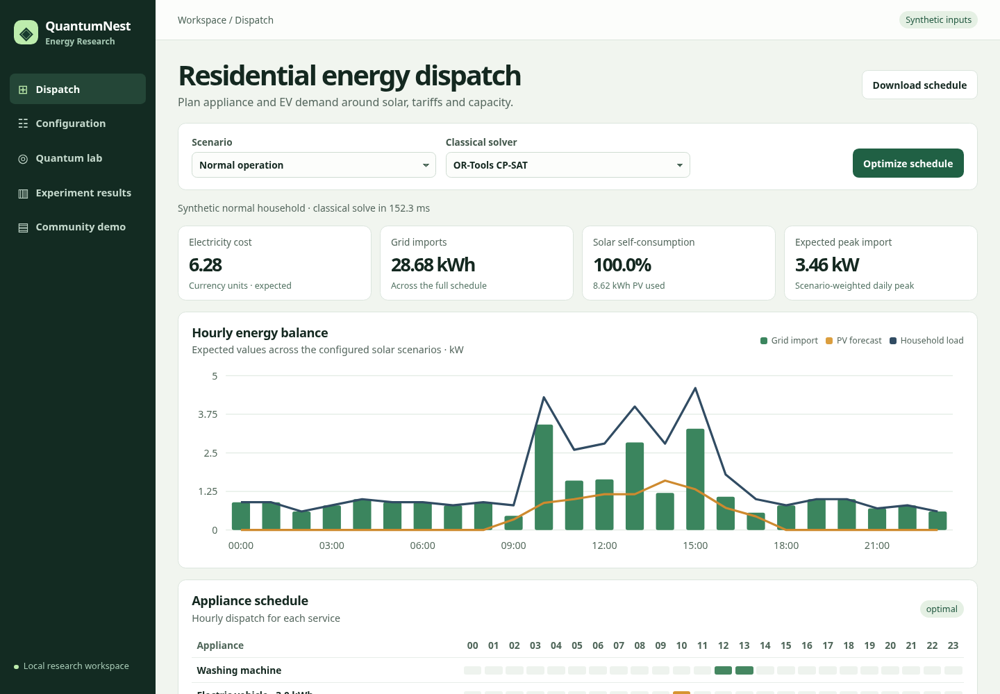
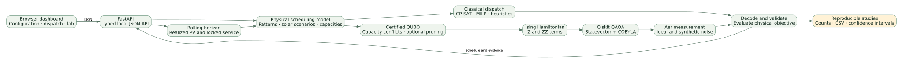
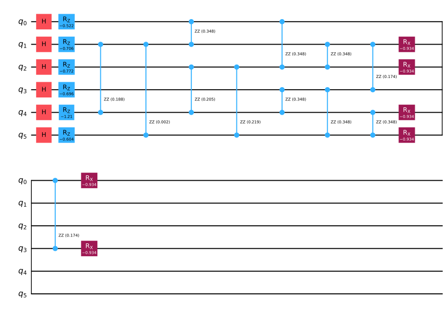
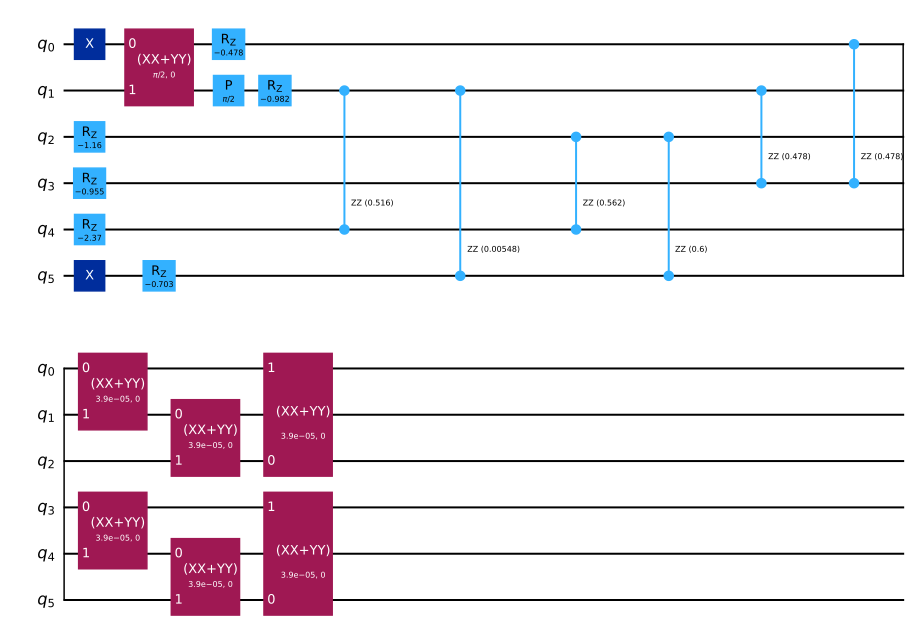
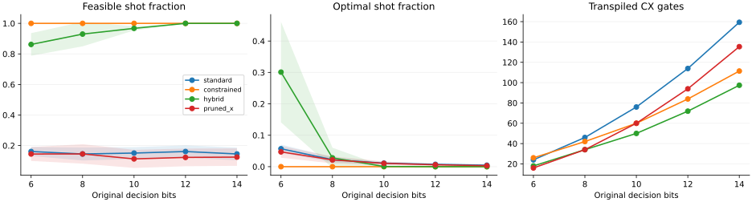

# QuantumNest

**Constraint-Efficient Hybrid QAOA for Uncertainty-Aware Residential Appliance and Electric Vehicle Scheduling with Rooftop Photovoltaics**

QuantumNest is a reproducible scheduling and quantum-encoding research project. It models residential electricity costs, appliance service windows, electric vehicle charging, rooftop PV uncertainty, and feeder and transformer limits. The normal household application uses classical optimization. Small, certified subproblems can also be evaluated using actual Qiskit circuits and Aer measurements.

**Research question.** Can physically justified domain pruning and one-hot-preserving mixing improve feasible sampling, circuit resources, and solution quality compared with penalty-based QAOA? The executed answer is mixed. The hybrid improved measured feasibility and reduced gate counts on the tested family, but it failed to sample the optimum at 12 and 14 original bits at depth one. Exact classical algorithms were faster and more reliable on these sizes.

**Source provenance.** Reconstructed from [Mind-Trainer/Quantum at source commit `748e1749090d8494ee57ac6cbb6f88313ee8afb9`](https://github.com/Mind-Trainer/Quantum/tree/748e1749090d8494ee57ac6cbb6f88313ee8afb9). The [upstream audit](legacy/README.md) documents confirmed issues, corrections, and the scope of the reused components.

## Application



- Configure continuous washer and dishwasher cycles, flexible interruption, a fixed-power EV load and battery target, availability, preferences, essential loads, and a labeled AC experiment. Edit hourly tariff, background load, PV, feeder limits, and transformer limits.
- Inspect the hourly schedule, grid imports, solar self-use, transformer headroom, and EV delivered energy. Download the decoded schedule as CSV.
- Replan after a forecast, preference or service change. The rolling update preserves executed hours, completed charging, and any in-progress non-interruptible cycle.
- Run ideal or synthetic-noise Qiskit Aer sessions in the quantum lab. Inspect the measured outcomes, actual parameter-bound and transpiled circuits, the interactive QUBO, and the exact classical comparison.
- Explore recorded research results and download run records, statistical summaries, input instances and manifests. The original community concepts are available under Community demo.

[Quantum lab screenshot](docs/screenshots/quantum-lab.png) · [Experiment explorer screenshot](docs/screenshots/experiment-results.png)

## Run locally

Use 64-bit **Python 3.12** on Windows or Linux. The browser UI uses vanilla JavaScript, CSS and HTML with FastAPI, so Node.js is optional for local use. Qiskit 2.2.3, Aer 0.17.2, NumPy, SciPy/HiGHS, OR-Tools, Matplotlib and transitive dependencies are pinned in [requirements.txt](requirements.txt). The project uses the Qiskit circuit API and an explicit SciPy optimization loop, which keeps the X and XY ansätze directly inspectable.

**Windows PowerShell**

```powershell
py -3.12 -m venv .venv
.\.venv\Scripts\python.exe -m pip install -r requirements.txt
.\.venv\Scripts\python.exe -m pip check
$env:OPENBLAS_NUM_THREADS = "1"
$env:OMP_NUM_THREADS = "1"
.\.venv\Scripts\python.exe -m backend
```

**Linux**

```bash
python3.12 -m venv .venv
source .venv/bin/activate
python -m pip install -r requirements.txt
python -m pip check
export OPENBLAS_NUM_THREADS=1 OMP_NUM_THREADS=1
python -m backend
```

Open [the local dashboard](http://127.0.0.1:8765/) and [interactive API documentation](http://127.0.0.1:8765/docs). Use `python -m backend --port 8766` if the default port is occupied. The service needs no hardware, accounts, API keys or paid services. In the quantum lab, select an included 6–14-bit research case. Larger or unrepresentable configurations use the classical dispatch path.

## Model and algorithms



[Mathematical formulation, proofs of equivalence, pseudocode and complexity](docs/model.md) · [Mermaid diagrams](architecture/README.md)

Each appliance selects one full service pattern, giving binary start variables for continuous cycles. The physical evaluator enforces windows and energy service, computes scenario-specific PV self-use and net import, and checks capacity against both gross feeder demand and transformer import including background load. Objective terms are expected electricity bill, expected peak import cost and resident inconvenience. Classical baselines include exhaustive search, MILP, CP-SAT, greedy tariff order, random feasible rejection, and simulated annealing.

1. **Standard QAOA.** Hadamard initialization, exact quadratic phase separator, X mixer, squared one-hot penalties and capacity-conflict terms. The separate explicit-slack fixture checks the conventional inequality encoding with three auxiliary qubits.
2. **Constraint-preserving QAOA.** A capacity-feasible initial W product and an ordered XY mixer preserve exactly one choice per group under ideal evolution. The mixer can reach a cross-appliance capacity conflict, which is penalized and identified during decoding.
3. **Constraint-efficient hybrid.** Classical capacity preprocessing removes impossible options and substitutes fixed choices before XY circuit construction. The compiler verifies that the small physical subproblem has an exact quadratic objective and capacity representation. A pruned X ablation isolates the pruning effect.

The circuit diagrams below come from measured runs at seed zero. The [circuit run data](results/raw/circuit_runs.json) records each bitstring histogram and trained parameter vector. [Standard transpiled](circuits/standard_transpiled.svg) · [XY transpiled](circuits/constrained_transpiled.svg) · [Hybrid transpiled](circuits/hybrid_transpiled.svg) · [Slack logical](circuits/standard_slack_logical.svg)

| Standard X | Constraint-preserving XY |
|---|---|
|  |  |

## Results



The main benchmark covers 6, 8, 10, 12, and 14 original decision bits, with 20 independent seeds per size and 256 shots per circuit condition. At 14 original bits and one ideal QAOA layer, the hybrid used 13 decision qubits and averaged 97.4 CX gates, compared with 14 qubits and 159.4 CX gates for standard. The feasibility increase was **85.47 percentage points**, with a 95% descriptive paired interval of 81.30–89.64. The hybrid returned no optimal shot across those 20 seeds, while the standard optimum probability was **0.47%** per shot. At 8 bits and one layer, combined synthetic gate/readout noise lowered hybrid feasibility from **92.99% to 45.94%**. The classical exact baselines returned the known optimum for every research instance.

[Methods, ablation and interpretation](research/results.md) · [Noise chart](results/figures/noise_depth.svg) · [Raw measurement runs](results/raw/runs.jsonl) · [Processed statistics](results/processed/summary.csv) · [Paired comparisons](results/processed/paired_differences.csv)

## Data and reproducibility

The quantum benchmarks use fully specified synthetic loads, PV forecasts, tariffs and appliance patterns. A separate replay uses a CC BY 4.0 measured hourly residual from 1,440 public UCI whole-house and submeter readings. Renewable generation, tariff, and scheduling assumptions remain synthetic in that replay. [Data provenance and reviewed public sources](datasets/README.md)

```bash
python -m pytest -q
python -m experiments.run --seeds 20 --shots 256 --budget 24
python -m experiments.demonstrations
```

Follow the platform setup above before executing these commands. The experiment runner writes `results/`. Use `--output another-directory` for independent reproductions. Wall-clock results depend on CPU, OS, load and threading. The controlled experiment uses a single CP-SAT worker and Aer thread. The CI workflow runs local model and API tests under Linux and Windows.

The optional Chromium integration uses a local browser and the same FastAPI app through an in-process HTTP router. [Browser check](scripts/browser_check.py)

```bash
python -m pip install -r requirements-browser.txt
python -m playwright install chromium
python -m scripts.browser_check
# For a system Chromium installation, pass --chromium /path/to/chromium.
```

## Repository guide

| Path | Contents |
|---|---|
| `frontend/`, `backend/` | Dashboard and typed FastAPI endpoints |
| `scheduling/`, `classical/`, `quantum/` | Physical model, rolling state, classical household and community solvers, QUBO, Ising and QAOA |
| `datasets/`, `experiments/`, `results/` | Sources, generators, executed run harness and evidence |
| `tests/`, `scripts/`, `.github/workflows/` | Validation, browser exercise and CI |
| `architecture/`, `circuits/`, `docs/`, `research/`, `legacy/` | Diagrams, documentation, literature and source audit |

## Research scope and references

This is an artifact-ready small-instance simulation study. The quantum compiler certifies representability by enumerating small pattern domains and therefore includes classical work strong enough to solve these cases exactly. Larger houses are solved classically, and the shared transformer coordination demonstration uses two households. The AC proxy cannot validate temperature or thermal comfort. Real-device execution, calibrated hardware noise, a field study and validation at 1,250 homes remain outside the measured scope. [Detailed conference-readiness assessment](research/results.md#readiness)

The [verified literature comparison](research/literature.md) covers PV-aware classical dispatch, quantum residential EV management, QAOA, XY mixers, slack-free capacity methods, and hybrid alternatives. QuantumNest evaluates established methods under a common physical model and reports their tradeoffs. The evidence supports a reproducible ablation study and no quantum-advantage claim.

Code and original documentation are under the [MIT License](LICENSE). The derived UCI profile retains the attribution and [CC BY 4.0 terms](datasets/README.md#measured-replay) of the underlying data.
