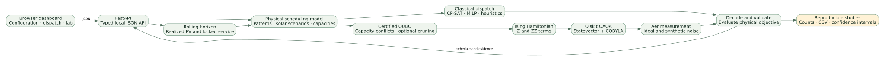
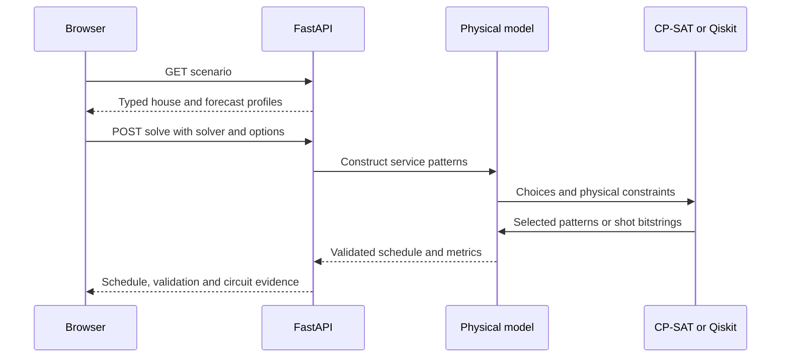
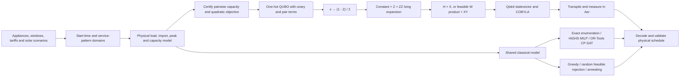
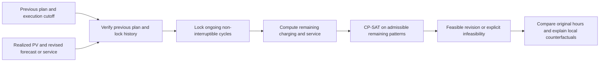
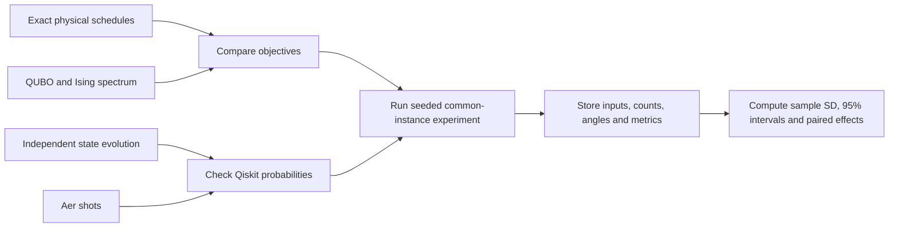

# System architecture

The browser and the Python API share one origin. The app uses the same service-pattern generator and evaluator as the experiment runner. The classroom community display reads only its isolated source-derived JSON fixture.

## Modeling, optimization and measurement

## Rolling update

## Experimental validation

Regenerate the overview SVG with `dot -Tsvg architecture/system.dot -o architecture/system.svg`. Circuit images are exported from executed circuits with `python -m experiments.demonstrations`.
