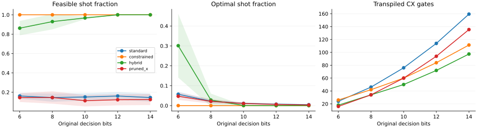
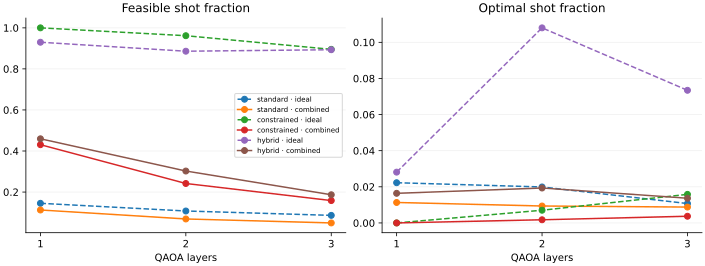

# Executed experiment and interpretation

The [run manifest](../results/manifest.json) records dependency versions, seed list, shots and all synthetic noise parameters. The [raw runs](../results/raw/runs.jsonl) include exact instance identifiers, selected schedules, shots, parameters, actual runtimes and violation counts. The [raw inputs](../results/raw/instances.jsonl) contain the full 24-hour profiles. The [summary](../results/processed/summary.csv) provides mean, sample standard deviation, descriptive 95% t intervals and the actual denominator per metric. [Paired differences](../results/processed/paired_differences.csv) compare methods within seed and size.

## Protocol

- Five unpruned sizes of 6, 8, 10, 12 and 14 decision bits, each with 20 independently generated synthetic instances. Seed numbers are reused across sizes, so a comparison across sizes has shared scenario structure. Within a size, each seed also selects optimizer initialization and the Aer stream. There are no independent optimizer restarts within an instance.
- Full two-group cases schedule a contiguous washer cycle and an EV in the same 24-hour environment under two PV scenarios. A background demand peak makes one EV hour universally impossible. Cross-service overlaps can violate capacity. All methods use identical tariffs, loads, physics, feasible solution sets and score.
- Standard penalty X, unpruned XY, hybrid XY and pruned X are the main four variants. The latter two isolate pruning at fixed mixer and compare mixing at fixed preprocessing. A measured depth-zero arm tests the feasible initializer at size eight.
- Variational training uses ideal Qiskit statevectors and a budget of 24 COBYLA evaluations per circuit, then 256 Aer shots. Angles trained in the ideal condition are reused across its noise arms. Runtime includes observed preprocessing, optimization, transpilation and one sampling condition. Measurement postprocessing and exact classical references are timed separately.
- Exhaustive enumeration, SciPy/HiGHS MILP, and OR-Tools CP-SAT serve as exact references. Greedy tariff scheduling uses first physically feasible choices in ordered alternatives. Uniform draws over complete schedules retain feasible samples. Random and annealing use 128 candidate assessments. Computational budgets and representations differ by solver and are reported rather than equated across paradigms.
- The eight-bit stress study uses QAOA layers 1–3. At p=1, it tests isolated one-qubit depolarization 0.003 on SX/X, isolated two-qubit depolarization 0.02 on CX, isolated symmetric readout flip 0.02, and their combination. At p=2–3 it tests the combined channel and ideal control. RZ is ideal in every arm. Qiskit transpiles to rz/sx/x/cx on all-to-all connectivity. The 60 ideal p=1 noise controls reuse their scaling runs, as marked in raw data.
- Feasibility and optimum probability use all shots. Best and expected feasible objectives are conditional on seeing at least one feasible shot. Missing results remain blank. Service and deadline metrics use the decoded output. No efficiency claim relies on making feasible-only results appear unconditional.

## Findings

Mean ideal results at depth one (20 seeds, feasibility and optimum percentages per shot).

| Original bits | Standard feasible % | Unpruned XY feasible % | Hybrid feasible % | Standard optimum % | Hybrid optimum % | Hybrid CX vs. standard CX |
|---:|---:|---:|---:|---:|---:|---:|
| 6 | 16.13 | 100.00 | 86.21 | 5.70 | 30.10 | 18.0 vs 24.0 |
| 8 | 14.51 | 100.00 | 92.99 | 2.23 | 2.81 | 34.0 vs 46.0 |
| 10 | 15.10 | 100.00 | 96.74 | 1.11 | 0.06 | 50.0 vs 76.0 |
| 12 | 16.11 | 100.00 | 100.00 | 0.74 | 0.00 | 71.9 vs 113.9 |
| 14 | 14.53 | 100.00 | 100.00 | 0.47 | 0.00 | 97.4 vs 159.4 |

At 14 original bits, the paired hybrid-minus-standard feasibility difference was +85.47 percentage points (95% descriptive CI +81.30 to +89.64). The hybrid used one fewer qubit and 62 fewer CX gates and its optimum probability was 0.47 percentage points lower (95% CI −0.72 to −0.22). Standard produced no feasible shot in three seeds. Among the 17 paired seeds with feasible output from both, the hybrid's best relative gap was 3.56 percentage points higher (95% CI +1.91 to +5.20). The hybrid remained 5.19% above optimum on average in that size group. The unpruned XY p=1 circuit yielded no optimal shot across the scaling instances. This is consistent with the basin favored by its safe initializer and shallow mixer. At eight bits the depth-zero XY arms already had complete feasible support and neither found the optimum. Feasibility improvements should be attributed in part to initialization and domain structure.

At eight bits and one layer, combined noise reduced feasible-shot fraction from 92.99% to 45.94% for hybrid, from 100.00% to 43.07% for unpruned XY, and from 14.51% to 11.25% for standard. Hybrid under combined noise fell to 18.67% at three layers. At p=2 under ideal simulation, the hybrid optimum fraction improved to 10.80%. The tested depth trend therefore has a quality versus noise tradeoff. These are circuit-simulator sensitivity experiments with no measured device calibration.

The three exact classical methods agreed on every instance. Their mean wall times at 14 bits were in the 1–15 ms range, versus roughly 0.2 s for hybrid and 0.4 s for standard. Even uniform random feasible rejection often matched exact solution quality under its defined candidate budget. The small subproblems and classical certification make this an encoding and validation study. It provides no evidence of computational quantum advantage.

## Separate demonstrations

- [Circuit runs](../results/raw/circuit_runs.json) are recorded separately. The slack fixture uses 6 decision qubits and 3 auxiliary qubits. Each QUBO and Ising validation runs as a test, and circuits were measured in Aer before drawing.
- The [household runs](../results/raw/household_runs.json) contain complete schedule data for seasonal, demand, capacity, preference and measured-residual replay inputs.
- The [rolling run](../results/raw/rolling_run.json) holds an active washer cycle, fixes completed and essential operations, lowers future PV and alters a pending preference. Explanations and scenario-specific energy balance are in the output.
- The [community run](../results/raw/community_run.json) exercises classical coordinated shared capacity on two homes. No community-scale quantum claim follows from it.

## Readiness

The implementation can support a reproducible artifact supplement, a workshop demo, and a bounded negative-result or encoding-ablation paper draft. A stronger conference paper still needs a more diverse workload with measured PV and load, multiple device groups, additional feasible-start strategies, independent optimizer restarts, and a more stringent noise and topology evaluation. Performance intervals are conditional on the chosen synthetic family and experiment design. They are descriptive and unadjusted for multiple testing.
